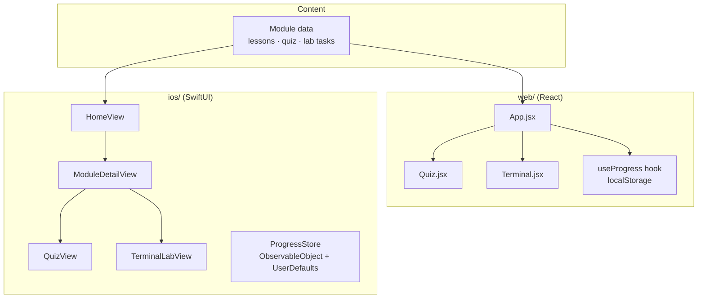

# CyberTrainer · Cybersecurity Training Apps

Two apps that teach practical security skills through **short lessons, quizzes and hands-on simulated terminal labs**, with **XP, levels and badges** to keep learners going.

| App | Stack | Run it |
|---|---|---|
| 🌐 Web | React 18 + Vite, deployed to GitHub Pages by GitHub Actions | **https://srikanthchinnala.github.io/cybersecurity-training-apps/** |
| 📱 iOS | SwiftUI (iOS 17), XcodeGen project, built in CI on macOS | see below |


## What's inside
- **Modules**: Phishing & email security, Network recon & ports, Linux logs & incident triage, and Web app security (OWASP)
- **Lessons**: bite-sized explanations written from a SOC analyst's point of view
- **Quizzes**: instant feedback, and XP for each correct answer
- **Terminal labs**: a simulated shell where you investigate a scenario step by step (grep an auth log, nmap a host, check SPF on a phishing email, curl response headers…). Commands are matched against expected patterns; nothing real runs
- **Progression**: XP → levels → ranks (Recruit → Security Lead), a daily streak, per-module completion and badges for finished labs
- **Persistence**: `localStorage` on the web, `UserDefaults` on iOS

## Architecture


## Run the web app
```bash
cd web
npm install
npm run dev        # http://localhost:5173
```

## Run the iOS app
Requires Xcode 15+ and [XcodeGen](https://github.com/yonaskolb/XcodeGen).
```bash
brew install xcodegen
cd ios
xcodegen generate
open CyberTrainer.xcodeproj   # run on an iOS 17 simulator
```

## CI/CD
- **web.yml**: installs dependencies, builds with Vite and deploys `web/dist` to GitHub Pages on every push to `main`
- **ios.yml**: on a macOS runner, generates the Xcode project with XcodeGen and compiles the app for the iOS Simulator (no code signing needed)

> Labs are simulations for learning. Only practise real tools on systems you are authorised to test.
